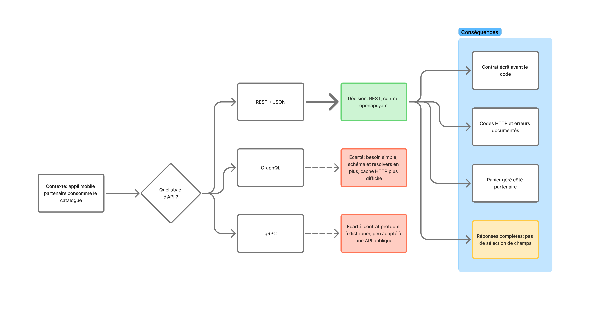

# API REST + JSON pour l'appli mobile partenaire, avec un contrat OpenAPI écrit avant le code

## Contexte

Une application mobile partenaire doit consommer le catalogue de ShopFlow et pouvoir passer commande. Ce n'est pas notre frontend Angular : nous ne contrôlons pas ce client, qui est développé par une autre équipe, à son rythme. L'API devient donc un **contrat public** : tout changement non annoncé peut casser l'application du partenaire.

Il faut choisir le style d'API (REST, GraphQL ou gRPC) et la façon de le documenter. Le besoin est simple : lister et filtrer des produits, afficher une fiche produit, passer une commande. Les contraintes du système (ADR-001) restent les mêmes : 200 commandes par jour, une équipe de 2 à 3 personnes, un temps de réponse cible de 1 à 1,5 seconde.

## Décision

Nous exposons une **API REST en JSON**, décrite par un contrat **OpenAPI 3** (`docs/openapi.yaml`) **écrit avant le code** des contrôleurs.

**Ressources exposées**
- `GET /products` : recherche avec filtres (`q`, `category`, `minPriceCents`, `maxPriceCents`, `inStockOnly`), tri (`sort`) et pagination (`page`, `pageSize`, 50 au maximum) ;
- `GET /products/{slug}` : détail d'un produit ;
- `POST /orders` : passer commande, avec l'en-tête `X-Cart-Token`.

**Conventions**
- Les montants sont des entiers en centimes (`priceCents`, `totalCents`), jamais des décimaux.
- Les erreurs ont un format unique : `{ status, message, fields }`. Les codes utilisés sont `404` (produit introuvable) et `422` (commande invalide : token absent ou panier vide). Les succès sont `200` et `201`.
- Le contrat est la référence : si le code et `openapi.yaml` divergent, on corrige l'un des deux avant de fusionner.

**Le panier est géré côté partenaire.** L'API publique ne contient pas de ressource `/cart`. Le partenaire garde son panier dans son application et le `X-Cart-Token` identifie le panier au moment de la commande (voir `docs/rabbitmq.md` pour un exemple de bout en bout).

## Alternatives considérées

- **GraphQL** : permet au client de choisir les champs, mais le besoin est simple (trois opérations). Il faudrait ajouter un schéma et des resolvers, et le cache HTTP devient plus difficile qu'avec des `GET` classiques. Écarté.
- **gRPC** : efficace, mais le contrat protobuf doit être distribué au partenaire et l'outillage est peu adapté à une API publique consommée par une autre équipe. Écarté.
- **REST sans contrat écrit d'avance (documentation après coup)** : plus rapide au départ, mais la documentation dérive du code, et le partenaire ne peut pas commencer son développement avant que le nôtre soit terminé. Écarté.

## Conséquences

**Positives**
- Le partenaire peut commencer à développer (et générer un client ou un mock) dès que le contrat est validé, sans attendre le backend.
- Les `GET` sont compatibles avec le cache HTTP ; les outils usuels (navigateur, Bruno, curl) suffisent pour tester.
- Les codes HTTP et le format d'erreur sont documentés et identiques sur toute l'API.

**Négatives et points de vigilance**
- **Réponses complètes** : il n'y a pas de sélection de champs. `GET /products` renvoie tout le produit (description, specs, images…) même si l'écran du partenaire n'affiche que le nom et le prix. À reconsidérer si le volume de données devient un problème, par exemple avec une vue « liste » allégée.
- **Le contrat doit rester à jour** : sans vérification automatique, rien n'empêche le code de diverger de `openapi.yaml`. Une vérification en CI (validation du contrat, test sur les réponses) reste à mettre en place.
- **Évolution du contrat** : l'API n'est pas versionnée (`1.0.0` dans le fichier, pas de préfixe `/v1` dans les URL). Un changement incompatible demandera une stratégie de versionnement à décider à ce moment-là.
- **Panier côté partenaire** : le serveur ne connaît le contenu du panier qu'au moment de la commande, et c'est la règle de Commande qui le valide (`422` si le panier est vide). Le partenaire doit gérer lui-même la persistance de son panier.
- Hors périmètre à ce stade : l'authentification de l'API (le `X-Cart-Token` identifie un panier, pas un partenaire), la limitation de débit et le suivi d'une commande après sa création.

